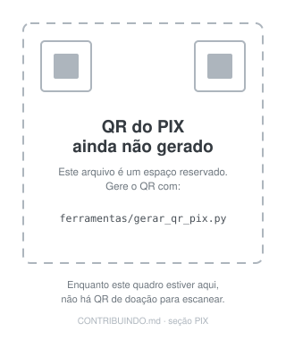

# Contribuir e apoiar o Bússola PDV

Obrigado por chegar até aqui. Este documento tem duas partes:

1. **[Como contribuir sem dinheiro](#parte-1--contribuir-sem-dinheiro)** — código, testes, documentação,
   relato de defeito, uso em loja de verdade. É o que mais ajuda.
2. **[Como apoiar financeiramente](#parte-2--apoiar-financeiramente)** — PIX, transferência bancária e
   PayPal, com os campos de recebimento.

> [!IMPORTANT]
> **Os campos de recebimento estão marcados como `«PREENCHER»`.** Eles são preenchidos pelo
> responsável pelo projeto, com dados reais e conferidos. Enquanto houver `«PREENCHER»` no arquivo,
> **nenhuma doação deve ser enviada** — e nenhum dado abaixo deve ser inventado, copiado de exemplo ou
> "completado" por palpite. Se você está lendo isto num fork, confira se o mantenedor do fork trocou
> os dados ou se eles ainda são daqui.

---

## Parte 1 — Contribuir sem dinheiro

### Relatar um defeito

O relato mais útil tem quatro coisas: **o que você fez**, **o que esperava**, **o que aconteceu** e
**em que ambiente** (versão do Bússola, Windows/Linux, resolução ou escala do monitor). Se der erro,
anexe:

- a captura da tela com a mensagem;
- o final de `logs/erros.log` (fica na pasta de dados; veja `bussola dados` no terminal);
- se o programa não abre, o resultado de `bussola info --banco <caminho do pdv.db>`.

**Nunca anexe** a base de produção (`pdv.db`) sem antes rodar
`python -m bussola_pdv.cli backup` e conferir se não há dado pessoal de cliente. Base com nome de
cliente, CPF e telefone é dado pessoal (LGPD) — mande uma base fictícia: `bussola demo` cria uma.

### Enviar código

1. Abra uma *issue* descrevendo o problema antes de uma mudança grande. Isso evita trabalho perdido —
   há decisões registradas em [`docs/DECISOES.md`](docs/DECISOES.md) que explicam por que certas coisas
   são como são.
2. Faça um *fork*, crie um ramo curto (`fix/sangria-negativa`, `feat/leitor-codigo-barras`).
3. Rode a suíte antes de abrir o *pull request*:

   ```bash
   pip install -e ".[dev]"
   make test      # pytest
   make lint      # ruff
   make tipos     # mypy
   make responsivo  # mede a interface de 640×440 a 2560×1440
   ```

4. No *pull request*, diga **o que muda**, **como você verificou** e **o que não foi testado**.

### Regras que o projeto não abre mão

Estas vêm de erros que já aconteceram aqui e estão registradas em [`docs/DECISOES.md`](docs/DECISOES.md):

| Regra | Por quê |
|---|---|
| **Dinheiro é inteiro em centavos** (`Dinheiro`), nunca `float` | somar centavos com ponto flutuante produz um centavo de diferença no fechamento |
| **A tela não calcula** — cálculo é domínio | o mesmo total tem de sair igual na tela, no Excel, no PDF e no cupom |
| **Toda alteração é auditada**, com trilha encadeada por hash | sem rastro não há como investigar divergência de caixa |
| **Nada de rede em tempo de execução** | o PDV roda em loja com internet ruim; o programa é offline por decisão |
| **Não afirmar o que não foi testado** | "funciona na térmica" só depois de imprimir em térmica; "gera .exe" só depois de rodar no Windows |
| **Nada de dado fictício em tela de produção** | módulo sem implementação aparece como não implementado, não como exemplo |

### Áreas onde ajuda é bem-vinda

- **Testes em Windows real** — sobretudo escala de 125%/150% e telas pequenas.
- **Impressoras térmicas** — relatos de modelo, largura de papel e ESC/POS que funcionaram.
- **Acessibilidade** — contraste, navegação por teclado, leitor de tela (nada disso foi verificado).
- **Tradução/revisão de texto** — as mensagens de erro são parte do produto.
- **Documentação** — se você se perdeu em algum passo, o documento está ruim: conserte.

---

## Parte 2 — Apoiar financeiramente

O projeto é **software livre sob GPL-2.0-or-later** e continuará sendo, com ou sem doação. Apoio
financeiro paga **tempo de manutenção**: testes em máquinas e impressoras reais, eventuais
certificados de assinatura de código para o instalador do Windows, e horas de correção de defeito.

### O que a doação **não** compra

Para não haver mal-entendido depois:

- **não** compra funcionalidade sob medida nem prioridade na fila;
- **não** compra suporte com prazo (não existe SLA, nem contrato, nem nota fiscal de serviço);
- **não** dá direito a versão "pro" — não existe versão fechada;
- **não** transfere titularidade, marca ou decisão sobre o rumo do projeto.

Doação é **espontânea, sem contrapartida**. Se você precisa de um sistema com suporte contratual,
garantia e emissão fiscal, este projeto não é (ainda) esse produto — veja os limites em
[README](README.md#limites-explícitos).

### PIX

| Campo | Valor |
|---|---|
| **Chave PIX** | `contato@davidalmeida.xyz` |
| **Tipo de chave** | `Email` |
| **Titular** | `David Lima de Almeida` |
| **Cidade do titular** | `São Paulo - SP` |

**Copia e cola** (gerado pela chave acima; enquanto estiver vazio, não há o que colar):

```text

```

**QR Code:**



> O arquivo `docs/doacoes/qr-pix.svg` que está no repositório é **um espaço reservado**, não um QR
> válido. Para gerar o de verdade, com a sua chave:

```bash
pip install "qrcode[pil]"
python ferramentas/gerar_qr_pix.py \
    --chave "«PREENCHER»" \
    --nome "«PREENCHER: nome do titular»" \
    --cidade "«PREENCHER: cidade»"
```

O comando imprime o **copia e cola**, grava `docs/doacoes/qr-pix.svg` e confere o CRC do payload.
Antes de publicar, escaneie o QR com o aplicativo do seu banco e faça uma transferência de teste de
R$ 1,00 para você mesmo: é o único jeito de saber que a chave está certa. Se quiser valor fixo
(ex.: R$ 10,00), acrescente `--valor 10,00`; sem isso, quem doa escolhe o valor.

### Transferência bancária

| Campo | Valor |
|---|---|
| **Banco** | `«PREENCHER: nome e código do banco, ex.: Banco do Brasil (001)»` |
| **Agência** | `«PREENCHER»` |
| **Conta** | `«PREENCHER: número e dígito»` |
| **Tipo de conta** | `«PREENCHER: corrente / poupança / pagamentos»` |
| **Titular** | `«PREENCHER: nome completo»` |
| **CPF/CNPJ do titular** | `«PREENCHER»` |
| **Chave Pix da mesma conta** | `«PREENCHER (opcional, mas transfere mais rápido)»` |

### PayPal

| Campo | Valor |
|---|---|
| **Link de doação** | `«PREENCHER: https://www.paypal.com/donate/?business=...»` |
| **paypal.me** | `«PREENCHER: https://paypal.me/...»` |
| **E-mail da conta PayPal** | `«PREENCHER»` |
| **Moeda** | `«PREENCHER: BRL / USD (defina uma e escreva aqui)»` |

> Para doação internacional (fora do Brasil), o PayPal é o caminho mais simples — o PIX só funciona
> entre contas brasileiras.

### Transparência

- **Recibo**: para doação de pessoa física a pessoa física não há nota fiscal de serviço. Se você
  precisar de comprovante para a sua contabilidade, peça por e-mail e será emitido um recibo simples
  descrevendo a doação. Doação recebida pode ter implicação tributária para quem recebe — a conversa
  é com contador, não com este documento.
- **Prestação de contas**: o que entrar é usado nas despesas listadas no topo desta seção. Quando
  houver gasto relevante (certificado, impressora de teste), ele é descrito no
  [CHANGELOG](CHANGELOG.md) ou numa *issue* marcada como `transparência`.
- **Privacidade**: o projeto **não** guarda nome de quem doou, nem publica lista de doadores, sem
  autorização expressa de quem doou.
- **Dados que nunca serão pedidos**: senha, token, código de verificação, acesso remoto ao seu
  computador ou à sua base de vendas. Se alguém pedir isso em nome do projeto, é golpe.

---

## Perguntas frequentes

**Doar dá alguma vantagem no programa?**
Não. O software é o mesmo para todos, e nenhuma funcionalidade é liberada por pagamento.

**Posso doar de outro país?**
Sim, pelo PayPal. PIX só entre contas brasileiras.

**Preciso doar para abrir uma *issue*?**
Não. Relato de defeito é gratuito e bem-vindo — inclusive de quem nunca doou nada.

**Aceita equipamento em vez de dinheiro?**
Impressora térmica 58/80 mm e um Windows antigo para testar são mais úteis que dinheiro, porque viram
teste automatizado. Escreva antes de enviar qualquer coisa.

**Sou empresa e quero patrocinar.**
Dá para apoiar como pessoa jurídica, mas **sem** contrapartida de exclusividade, marca ou suporte: as
regras são as mesmas da seção [o que a doação não compra](#o-que-a-doação-não-compra). Para apoio com
contrapartida, o caminho é contrato de prestação de serviço, que este projeto não oferece.

---

## Licença

Contribuições enviadas por *pull request* entram sob a mesma licença do projeto,
**GPL-2.0-or-later** (veja [LICENSE](LICENSE)). Ao abrir um *pull request* você confirma que tem
direito de licenciar o código que está enviando.
