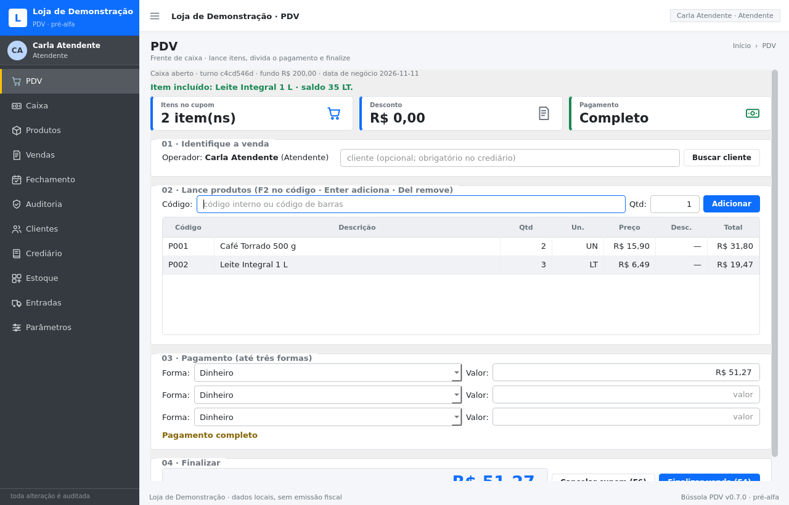
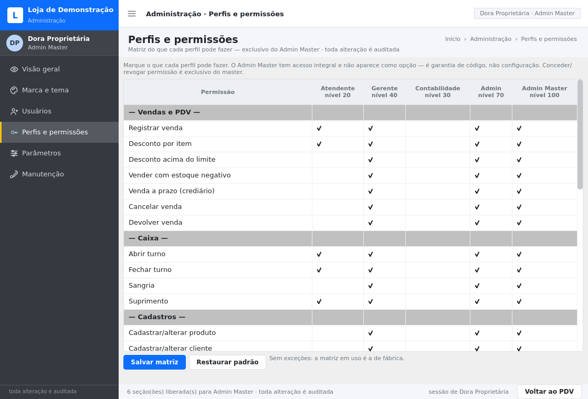
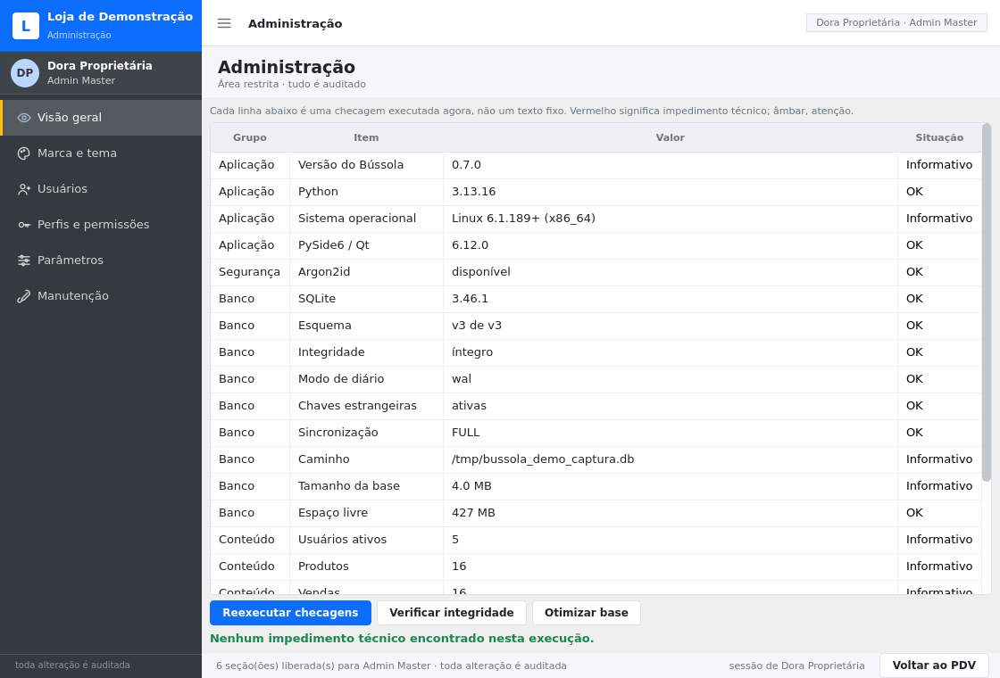
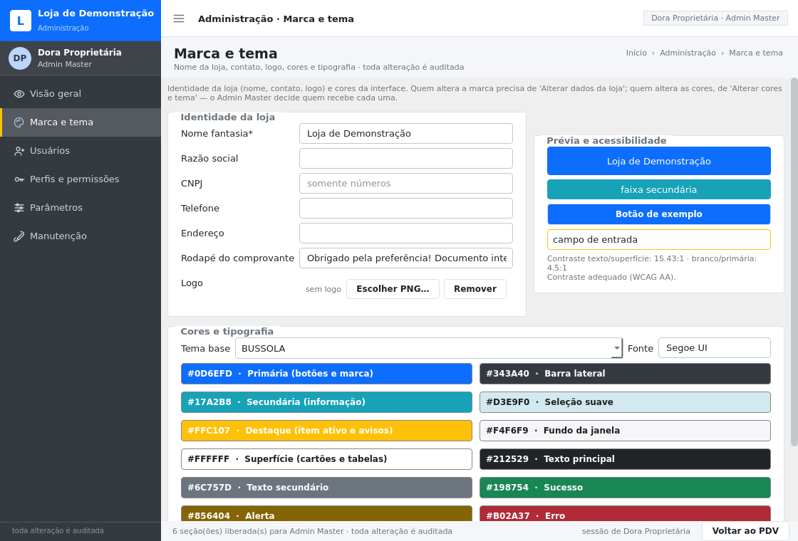
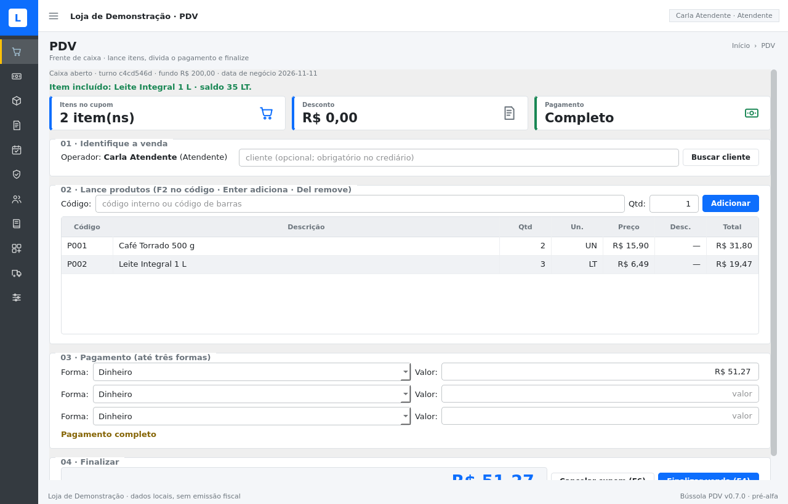
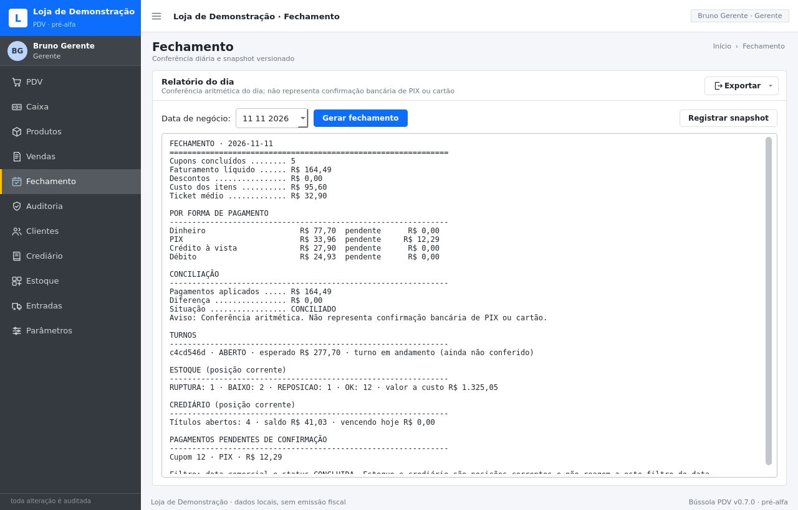
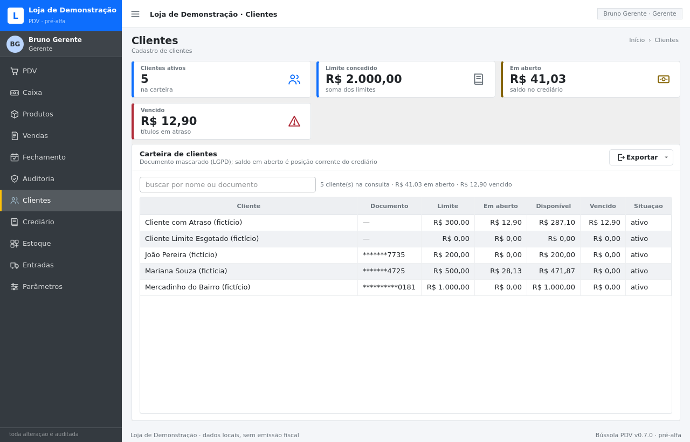

# Bússola Sistema PDV Open Source

PDV desktop **offline**, em Python + PySide6 + SQLite, para varejo brasileiro.

> **Estado: pré-alfa funcional (v0.7.0).** O núcleo de domínio, a persistência, os casos de uso de
> venda/caixa/crediário/estoque/fechamento, a trilha de auditoria, a interface inicial e a área
> administrativa com hierarquia de perfis e tema da loja existem e têm testes automatizados.
> Há caminho de instalação no Windows — rodando do código **ou** por executável/instalador, ver
> [docs/INSTALACAO_WINDOWS.md](docs/INSTALACAO_WINDOWS.md) — e todo relatório sai em **Excel e PDF**
> ([docs/EXPORTACAO.md](docs/EXPORTACAO.md)), inclusive das telas de clientes, crediário, estoque e
> do turno de caixa. **Não é homologado para operação real**,
> não emite documento fiscal, não suporta múltiplas estações em rede e não substitui contador ou
> sistema fiscal certificado.
> Leia [docs/PLANO_IMPLEMENTACAO.md](docs/PLANO_IMPLEMENTACAO.md) e [docs/DECISOES.md](docs/DECISOES.md)
> antes de qualquer uso com dados reais.

A implementação em Python e o material de especificação/protótipo que a originou vivem **no mesmo
diretório**, separados por papel: código em `src/` e `tests/`; documentação vigente em `docs/`;
material histórico e planilhas em `prototipo/` (que **não** é executado nem é fonte de verdade).
O diagnóstico do que existia antes está em [docs/ANALISE_REPOSITORIO.md](docs/ANALISE_REPOSITORIO.md)
e o inventário do material antigo em [prototipo/README.md](prototipo/README.md).





## O que já funciona

- **Venda atômica e idempotente**: venda, itens, pagamentos, saída de estoque, títulos e auditoria
  entram na mesma transação. Falha em qualquer etapa → rollback total (testado com falha injetada).
- **Pagamento dividido em até 3 formas**, com troco limitado a dinheiro; PIX/cartão nascem
  `PENDENTE` e exigem confirmação registrada.
- **Caixa por turno**: um único turno aberto por caixa (garantido por índice no banco), sangria com
  autorização, suprimento, contagem por denominação e fechamento com justificativa de diferença.
- **Crediário**: parcelas com trava de fim de mês, recebimento parcial/total, aging 1–30/31–60/61–90/
  >90, limite e bloqueio por atraso — sem encargos inventados.
- **Estoque** por movimentos assinados, status ruptura/baixo/reposição/OK, rateio de frete com soma
  exata em centavos.
- **Auditoria append-only** com triggers que abortam `UPDATE`/`DELETE` e cadeia SHA-256 verificável.
- **Segurança**: Argon2id, bloqueio por tentativas, autorização por ação exige autenticação de outro
  usuário com permissão.
- **Hierarquia de cinco perfis** (`ADMIN_MASTER > ADMIN > GERENTE > CONTABILIDADE > ATENDENTE`) com
  matriz de permissões editável **apenas pelo Admin Master**, aplicada na hora e auditada.
- **Marca e tema da loja** editáveis no painel (nome, razão social, CNPJ, endereço, rodapé do cupom,
  logo) e paleta de cores com presets claro/escuro — o tema vale para a interface inteira.
- **Área administrativa** com diagnóstico real de dependências, cadastros, parâmetros, cópias de
  segurança verificadas e restauração.
- **Consultas de operação**: telas de **Clientes** (limite, em aberto, disponível, vencido),
  **Crediário** (parcelas, atraso em dias, saldo por título) e **Estoque** (saldo, mínimo, ponto de
  pedido, situação, valor a custo), cada uma com busca e exportação em Excel/PDF.
- **Interface no vocabulário do AdminLTE**: barra lateral recolhível com ícones desenhados no
  projeto, barra superior, trilha de navegação, cartões, indicadores (*small-box*), etiquetas de
  status e rodapé — tudo pintado pela paleta da loja.
- **Backup consistente** pela API do SQLite, com verificação de integridade e teste de restauração.
- **Pasta de dados escolhível**: na primeira execução (com validação de escrita), depois em
  *Administração → Manutenção* ou por `bussola dados --definir "D:\PDV" --mover`; a escolha fica em
  `%APPDATA%\BussolaPDV\instalacao.json` e a origem é sempre reportada.
- **Falha nunca é silenciosa**: erro na inicialização aparece em tela e vai para `logs/erros.log` —
  o executável não tem console para mostrar traceback.
- **Demonstração offline** com 16 produtos, 5 clientes, 16 vendas em 3 dias, uma venda cancelada e um
  crediário de 3 parcelas — tudo fictício.

## Hierarquia de perfis

O nível é um número; quem está acima gerencia quem está abaixo, e ninguém edita o próprio acesso.

| Perfil | Nível | Em uma frase |
|---|---|---|
| **Admin Master** | 100 | proprietário da instalação: define o que cada perfil acessa, faz backup e restauração |
| **Admin** | 70 | opera o sistema inteiro (cadastros, parâmetros, usuários abaixo dele), sem mexer na matriz |
| **Gerente** | 40 | autoriza desconto acima do limite, sangria, estoque negativo, cancelamento e fechamento |
| **Contabilidade** | 30 | só leitura: relatórios, fechamentos, títulos, auditoria — não vende, não cancela |
| **Atendente** | 20 | frente de caixa: vende, consulta preço e abre/fecha o próprio turno |

A matriz de permissões tem uma linha por ação (venda, caixa, cadastro, relatório, administração) e uma
coluna por perfil. **A coluna do Admin Master é intocável** — ele tem acesso integral por garantia de
código, não por configuração. Só o master abre a matriz; toda concessão/revogação gera evento de
auditoria com antes/depois, e a instalação recusa ficar sem nenhum master ativo.

## Área administrativa

Aberto pelo menu **Administração** (ou `bussola ui --admin`) e só aparece para quem tem a permissão
de acesso; as seções aparecem conforme o perfil, então um Admin vê cinco e o master vê seis.

| Seção | O que faz |
|---|---|
| Visão geral | diagnóstico executado na hora: Python, PySide6, Argon2id, SQLite, versão do esquema, integridade, WAL, `synchronous`, espaço livre, tamanho real da base, contagens |
| Marca e tema | identidade da loja, logo PNG opcional, paleta com prévia de contraste (WCAG AA) e presets |
| Usuários | criar, ativar/desativar, trocar perfil (respeitando o nível) e redefinir senha |
| Perfis e permissões | matriz do que cada perfil pode fazer — exclusiva do Admin Master |
| Parâmetros | descontos, crediário, caixa e segurança, com faixa válida por parâmetro |
| Manutenção | cópia de segurança verificada, verificação de integridade/cadeia de auditoria, otimização e restauração (master) |

Nada ali é maquete: cada linha do diagnóstico vem de uma consulta ao ambiente ou ao banco, e o rodapé
informa quantas seções o perfil tem liberadas.




## Interface

A casca é inspirada no [AdminLTE](https://github.com/ColorlibHQ/AdminLTE) (MIT) — barra lateral
escura com a marca no topo, painel do usuário, menu com ícones, barra superior com botão de recolher,
cabeçalho de página com trilha, cartões e *small-boxes* de indicador. Nada do projeto original é
copiado: o CSS do AdminLTE não entra aqui, e os ícones são 25 SVGs desenhados neste repositório.
Como a folha de estilo é gerada a partir da paleta da loja, trocar o tema no painel administrativo
repinta a interface inteira — sidebar, cartões, tabelas e indicadores.

| Tela | Indicadores exibidos |
|---|---|
| PDV | itens no cupom, desconto aplicado, situação do pagamento (falta / troco / completo) |
| Caixa | fundo de troco, esperado na gaveta, movimentos do turno |
| Produtos | ativos, sem estoque, abaixo do mínimo |
| Vendas | cupons do período, faturamento, ticket médio |
| Fechamento / Auditoria | relatório e trilha dentro de cartões, com ferramentas no cabeçalho |
| Clientes | clientes ativos, limite concedido, em aberto e vencido |
| Crediário | títulos em aberto, saldo a receber, atraso e saldo vencido |
| Estoque | em ruptura, abaixo do mínimo, valor a custo |

**Entradas** e **Parâmetros** ainda são páginas marcadas como não implementadas — nada ali é
simulado.

Detalhes de tokens, componentes e regras em [docs/INTERFACE.md](docs/INTERFACE.md).



## Exportação (Excel e PDF)

Todo relatório tem o botão **Exportar** no cabeçalho do cartão, com dois formatos:

| Tela | Relatório | Conteúdo |
| --- | --- | --- |
| Fechamento | Fechamento do caixa | resumo, por forma de pagamento, por operador, conciliação, turnos, pendentes, estoque, crediário |
| Vendas | Vendas do período | cupons do período com total, aplicado e status |
| Produtos | Catálogo e estoque | saldo, custo, preço e situação por produto |
| Auditoria | Trilha de auditoria | eventos com ator, entidade e motivo |
| Caixa | Fechamento do turno | fundo, vendas em dinheiro, recebimentos, sangrias, suprimentos, esperado, contado, diferença, movimentos e contagem por denominação |
| Clientes | Clientes | limite, em aberto, disponível e vencido por cliente (documento mascarado) |
| Crediário | Crediário | títulos com vencimento, principal, recebido, saldo, atraso e status |
| Estoque | Estoque | saldo, mínimo, ponto de pedido, situação e valor a custo + resumo por situação |

- **Excel (.xlsx)**: aba `Resumo` + uma aba por tabela, com filtro automático, cabeçalho congelado,
  **valores como número** (dá para somar) e **datas como data**.
- **PDF**: A4 com identificação da loja, indicadores, tabelas, avisos e rodapé `página X de Y`.
- Exportar exige a permissão `EXPORTAR_DADOS` (master, admin, gerente e contabilidade) e **fica na
  trilha de auditoria** com autor, formato, filtros e nome do arquivo.
- Arquivos de exemplo (dados fictícios): [`fechamento-exemplo`](docs/exemplos/fechamento-exemplo.pdf),
  [`turno-exemplo`](docs/exemplos/turno-exemplo.pdf) e [`estoque-exemplo`](docs/exemplos/estoque-exemplo.pdf),
  cada um em `.pdf` e `.xlsx`.

Pela linha de comando (senha em `BUSSOLA_SENHA` ou no prompt):

```bash
bussola exportar --banco dados/pdv.db --tipo fechamento --data 2026-11-11 \
    --formato pdf --login master
bussola exportar --banco dados/pdv.db --tipo vendas --de 2026-11-01 --ate 2026-11-11 \
    --formato xlsx --login gerente
bussola exportar --banco dados/pdv.db --tipo estoque --formato xlsx --login gerente
bussola exportar --banco dados/pdv.db --tipo turno --formato pdf --login master
```

Tipos disponíveis: `fechamento`, `vendas`, `catalogo`, `auditoria`, `crediario`, `clientes`,
`estoque` e `turno` (`--turno <id>` para um turno específico, `--incluir-pagos` no crediário).

Detalhes, limites e checklist de conferência em [docs/EXPORTACAO.md](docs/EXPORTACAO.md).





## Instalação

Há dois caminhos. O guia completo, com passo a passo para leigo, solução de
problemas e checklist de validação, está em
**[docs/INSTALACAO_WINDOWS.md](docs/INSTALACAO_WINDOWS.md)**.

### Windows — instalador (mais simples)

Baixe `BussolaPDV-<versão>-setup.exe` (ou o `.zip` portátil) nas
[Releases](https://github.com/davidcreator/bussolapdv/releases), execute e siga o assistente.
Na primeira abertura o próprio programa pede o nome da loja e cria o Admin Master.
O binário **não é assinado digitalmente**: o SmartScreen avisa na primeira execução — o guia
explica por quê e como conferir o SHA-256.

Os artefatos saem do workflow [`.github/workflows/windows.yml`](.github/workflows/windows.yml)
(runner `windows-latest`) ou do seu próprio build, em uma máquina Windows:

```bat
py -3.12 -m venv .venv
.venv\Scripts\activate
python -m pip install -e ".[empacotamento]"
powershell -ExecutionPolicy Bypass -File empacotamento\build_windows.ps1
```

Saída: `dist\BussolaPDV\BussolaPDV.exe`, `dist\BussolaPDV-<versão>-win64.zip` e
`dist\instalador\BussolaPDV-<versão>-setup.exe` (Inno Setup 6).

### Windows — rodando do código

Requer [Python 3.12 x64](https://www.python.org/downloads/windows/) — marque
**“Add python.exe to PATH”** no instalador.

```bat
py -3.12 -m venv .venv
.venv\Scripts\activate
python -m pip install -e .

bussola init --banco dados\pdv.db --admin-login master --admin-nome "Seu Nome"
bussola-pdv --banco dados\pdv.db
```

Pacotes de execução (o resto vem como dependência deles):

| Pacote | Versão | Papel |
| --- | --- | --- |
| `PySide6-Essentials` | `>=6.6,<7` | interface Qt 6; no Windows as DLLs já vêm no wheel |
| `argon2-cffi` | `>=23.1,<26` | hash de senha Argon2id |

Extras: `dev` (`pytest`, `pytest-cov`, `ruff`, `mypy`) e `empacotamento` (`pyinstaller`).
Nenhuma dependência de sistema extra no Windows. Base e cópias ficam em
`%LOCALAPPDATA%\BussolaPDV` (sobreponível com a variável `BUSSOLA_DADOS`), fora da pasta do programa.

### Linux (desenvolvimento)

```bash
python -m venv .venv
source .venv/bin/activate
pip install -e ".[dev]"
```

O Qt precisa de bibliotecas de sistema
(`libxkbcommon0 libgl1 libegl1 libfontconfig1 libdbus-1-3`); `make test` usa Qt offscreen.

## Uso rápido

```bash
# base fictícia completa + interface
bussola demo --banco dados/demo.db
bussola ui --banco dados/demo.db
# usuários: master / admin / gerente / contabilidade / operador — senha: Bussola#2026

# base vazia com administrador (pergunta a senha ou usa BUSSOLA_SENHA_ADMIN)
bussola init --banco dados/bussola.db

# diagnóstico, relatório e cópia de segurança
bussola info --banco dados/demo.db
bussola fechamento --banco dados/demo.db --data 2026-11-11
bussola backup --banco dados/demo.db --destino copias/
```

Sem instalar o pacote: `PYTHONPATH=src python -m bussola_pdv.cli <comando>`.

## Desenvolvimento

```bash
make test        # pytest (Qt em modo offscreen)
make lint        # ruff
make tipos       # mypy
make capturas    # gera docs/capturas/*.png sem servidor gráfico
make responsivo  # mede a interface de 800×600 a 1920×1080 e aponta o que estoura
make limpar      # remove caches
```

Atalhos na tela de PDV: `F2` foca o código, `Enter` adiciona, `Del` remove o item selecionado,
`F4` finaliza, `F6` cancela o cupom, `Esc` limpa a mensagem.

## Estrutura

```
src/bussola_pdv/
  dominio/         regras puras (dinheiro, venda, pagamentos, caixa, crediário, estoque, auditoria)
  aplicacao/       casos de uso, transações, autorização, relatórios
  infra/sqlite/    conexão, migrações versionadas, repositórios, massa demo
  ui/              PySide6: casca (sidebar/topbar/cartões), tema, ícones, login, PDV, caixa, consultas,
                   telas de clientes/crediário/estoque, primeiro uso e entrada do app empacotado
  ui/exportacao.py botão Exportar (menu Excel/PDF) usado em todas as telas de relatório
  dominio/relatorio.py  Relatorio/Tabela/Coluna: o documento como dado, sem formato
  aplicacao/exportacao.py  monta fechamento/vendas/catálogo/auditoria/crediário/clientes/estoque/turno
                   e grava com auditoria
  infra/exportacao/ escritores .xlsx (biblioteca padrão) e .pdf (Qt), mais formatação pt-BR
  ui/admin/        área administrativa: diagnóstico, marca, usuários, permissões, parâmetros, manutenção
  cli.py           linha de comando (init, demo, info, backup, fechamento, ui)
  caminhos.py      onde ficam os dados: padrão do sistema, pasta escolhida ou BUSSOLA_DADOS
  diagnostico.py   log de erro e caixa de diálogo para exceção não tratada (app sem console)
tests/             563 testes: unidade, integração com SQLite real, falhas, UI offscreen,
                   exportação e empacotamento
empacotamento/     PyInstaller (.spec, ícone, metadados), Inno Setup (.iss), build_windows.ps1
docs/              análise do repositório de origem, decisões (ADRs), interface, instalação no
                   Windows, plano e capturas
```

## Limites explícitos

- **Não** é sistema fiscal e não emite NFC-e/SAT; a marca personalizada muda a interface e o rodapé
  do comprovante interno, nunca um documento fiscal.
- **Não** suporta vários computadores vendendo ao mesmo tempo; arquivo SQLite em rede não é suportado.
- A trilha de auditoria detecta adulteração, mas **não** impede um administrador do sistema de
  reescrever o banco inteiro.
- Pagamentos eletrônicos são registro manual; nenhuma integração bancária está homologada.
- **Cadastro e operação pelas telas de Clientes/Crediário/Estoque**: elas consultam e exportam; criar
  cliente, receber título e lançar entrada de estoque ainda dependem do serviço/CLI.
- Encargos de crediário, devolução parcial, importação da planilha e **geração do `.exe` neste
  ambiente Linux** continuam pendentes (ver plano); o PDF de fechamento existe desde a v0.5.0.

## O que é (e não é) o diretório `prototipo/`

`prototipo/especificacao/` guarda o material original: 23 documentos, 20 planilhas `.xlsx`, 5 módulos
VBA e 20 scripts que geraram as planilhas. Ele é referência histórica e de regra de negócio; a
aplicação não lê nem executa nada dali. Antes de abrir qualquer planilha como se fosse o sistema,
leia [prototipo/README.md](prototipo/README.md).

## Licença

GPL-2.0-or-later — veja [LICENSE](LICENSE) e [NOTICE.md](NOTICE.md). As imagens de referência do
repositório de origem **não** foram incorporadas. O nome é marca tipográfica provisória; não há
logotipo aprovado.
