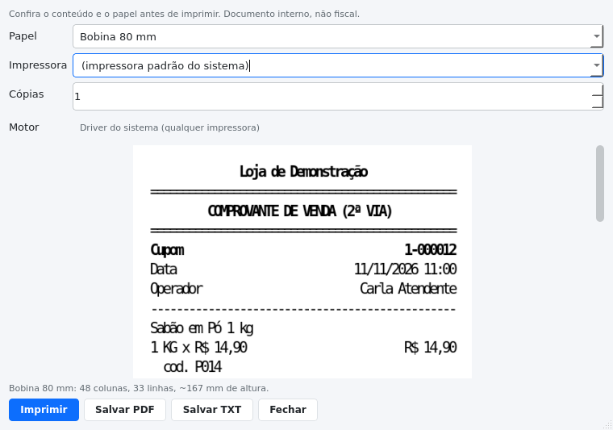
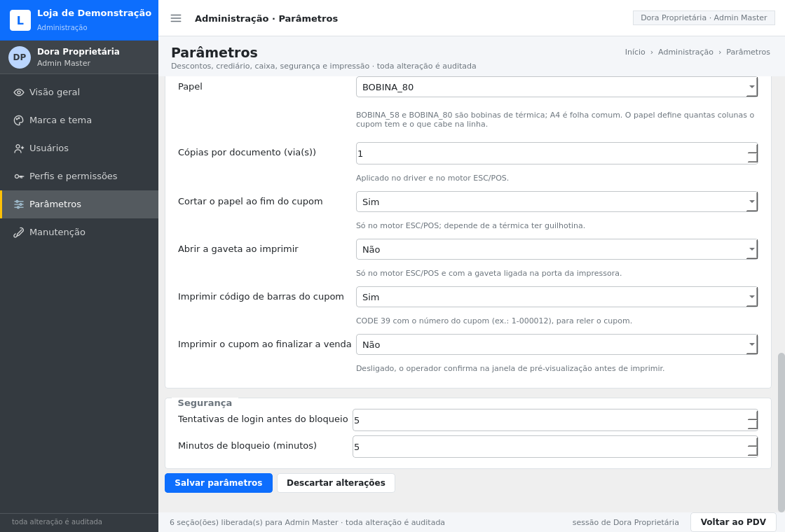

# Impressão: bobina térmica e folha comum

Este documento explica **o que foi entregue** na v0.8.0, **como configurar** na loja e
**o que foi testado de fato** — separando o que é verificado automaticamente do que só se
confirma em impressora de verdade.

> Escopo declarado: o cupom do Bússola PDV é **documento interno, não fiscal**. Ele não
> substitui NFC-e/SAT, não confirma liquidação de PIX/cartão e não tem valor contábil.
> Impressão fiscal é assunto do fornecedor fiscal da loja (ver P1 em `docs/DECISOES.md`).

---

## 1. O que a loja consegue fazer

| Suporte | Impressora típica | Como sai |
|---|---|---|
| Bobina 58 mm | POS-58, MP-58, térmica de mesa pequena | cupom de 32 colunas, código de barras, corte |
| Bobina 80 mm | POS-80, Elgin i9, Bematech MP-4200, Epson TM-T20 | cupom de 48 colunas, corte, gaveta |
| Folha A4 | jato de tinta ou laser comum | mesmo conteúdo no papel do escritório, com o dobro de colunas |

Três caminhos de saída, todos a partir **do mesmo documento**:

1. **Pré-visualizar e imprimir** — de onde se imprime, hoje:
   | Onde | O que sai | Permissão |
   |---|---|---|
   | PDV, ao finalizar a venda | cupom da venda | `CUPOM_REIMPRIMIR` |
   | PDV, **F8** | 2ª via da última venda da estação | `CUPOM_REIMPRIMIR` |
   | **Vendas** → "Reimprimir cupom" | 2ª via da venda selecionada (qualquer venda do período) | `CUPOM_REIMPRIMIR` |
   | Caixa → "Imprimir turno" / após fechar | conferência do turno | `CUPOM_REIMPRIMIR` |
   | Fechamento, Vendas, Produtos, Auditoria, Clientes, Crediário, Estoque | o relatório da tela, com o filtro atual | `EXPORTAR_DADOS` |
   | `bussola imprimir` (CLI) | cupom ou qualquer relatório | a mesma do tipo |
2. **Salvar PDF** — o mesmo desenho, no tamanho exato do papel (57,9 × 175 mm de bobina
   vira uma página única, não um A4 com um cupom perdido no canto);
3. **Salvar TXT** — texto de largura fixa, para mandar por WhatsApp/e-mail ao suporte ou
   ler no Bloco de Notas do Windows.

> Cupom e relatório têm permissões **diferentes** de propósito: cupom é operação de balcão
> (o atendente imprime a 2ª via do cliente); relatório é dado saindo da loja, então exige
> `EXPORTAR_DADOS`, a mesma de exportar. A checagem é feita no serviço, não só escondendo o
> botão.

Exemplos versionados em `docs/exemplos/`:
`cupom-exemplo-bobina58.pdf`, `cupom-exemplo-bobina80.pdf`, `cupom-exemplo-a4.pdf`,
`cupom-exemplo-58mm.txt` (conteúdo **fictício** da massa de demonstração).



---

## 2. Configuração na loja

Administração → **Parâmetros** → grupo **Impressão**:

| Parâmetro | Valores | Para que serve |
|---|---|---|
| `impressao.motor` | `SISTEMA` (padrão) / `ESCPOS` | como os bytes chegam à impressora |
| `impressao.impressora` | nome do Windows ou vazio | vazio = impressora padrão do sistema |
| `impressao.papel` | `BOBINA_58` / `BOBINA_80` (padrão) / `A4` | quantas colunas o cupom tem |
| `impressao.copias` | 1 a 5 | vias por documento |
| `impressao.cortar_papel` | sim/não | guilhotina no fim do cupom (só ESC/POS) |
| `impressao.abrir_gaveta` | sim/não | pulso de gaveta ao imprimir (só ESC/POS) |
| `impressao.codigo_de_barras` | sim/não | CODE 39 com o número do cupom |
| `impressao.imprimir_automatico` | sim/não | imprime ao finalizar a venda, sem clique extra |



O campo **Impressora** lista o que está instalado no sistema e continua aceitando nome
digitado — porque impressora de rede offline às vezes não aparece na lista, e o lojista
sabe o nome exato.

### Quando usar cada motor

**`SISTEMA` — recomendado para começar.**
Passa pelo driver instalado (spooler do Windows, CUPS no Linux/macOS). Funciona em
qualquer impressora, inclusive térmica com driver do fabricante, e imprime A4. Não faz
corte automático nem abre gaveta — isso é do driver, não do sistema.

**`ESCPOS` — para térmica compatível (Elgin, Bematech, Epson TM, POS-58/80).**
Manda bytes crus na fila local, sem driver interpretar. É o único jeito de ter **corte
automático**, **gaveta** e **código de barras nativo**. No Windows vai por `winspool.drv`
(chamado direto, sem `pywin32`); no Linux/macOS por `lp -o raw`. Exige bobina: pedir A4
nesse motor é recusado com mensagem, não com cupom torto.

> Se a térmica só tiver driver gráfico, `ESCPOS` falha com "recusou o documento cru".
> Nesse caso a loja usa `SISTEMA` — o cupom sai igual, só sem corte automático.

---

## 3. Como funciona por dentro

```
                 aplicacao/impressao.ServicoImpressao
                 (lê parâmetros, monta o cupom, audita)
                                 │
                     dominio/impressao.py  ← o documento é DADO
                (blocos: Texto, Par, Item, Divisor, CódigoDeBarras)
                                 │  layout() quebra em linhas de largura fixa
        ┌────────────────────────┼─────────────────────────┐
        ▼                        ▼                         ▼
 infra/impressao/papel.py   infra/impressao/escpos.py   infra/impressao/texto.py
 driver do sistema ou PDF   bytes crus (corte/gaveta)   prévia e .txt
```

Decisões que custaram iteração e estão registradas em ADR-022:

* **grade de colunas, não texto corrido** — cada caractere é pintado na coluna que lhe
  cabe. Sem isso, valor alinhado à direita não fica sob o outro quando a fonte do sistema
  é proporcional;
* **ênfase vira negrito no papel comum** — dobrar o tamanho do título estourava a bobina
  de 58 mm e sobrepunha linhas (aconteceu na primeira versão do desenho). Na térmica o
  duplo continua sendo o comando nativo `GS !`;
* **CODE 39** — é o único simbólico que qualquer térmica ESC/POS imprime sozinha
  (`GS k 4`) e que dá para desenhar à mão no PDF (barras de 1 e 3 módulos, razão 3:1).
  Largura limitada a 60 mm para não virar um borrão de 18 cm em A4;
* **acento** — o ESC/POS recebe texto transliterado (`Café` → `Cafe`) porque a página de
  código da térmica varia por fabricante; o PDF e o TXT mantêm o acento.

### Auditoria

Cada envio grava evento na trilha append-only:

* `IMPRESSAO_REALIZADA` — documento, rótulo, papel, motor, impressora, linhas, cópias;
* `IMPRESSAO_FALHOU` — os mesmos campos **mais** o motivo e o código do erro.

Sem isso, "saiu o cupom da venda 45?" não teria resposta conferível.

### Permissão

Duas ações, por tipo de papel:

| Papel | Ação exigida | Quem tem por padrão |
|---|---|---|
| cupom / conferência de turno | `CUPOM_REIMPRIMIR` | Admin Master, Admin, Gerente, Atendente |
| relatório da tela | `EXPORTAR_DADOS` | Admin Master, Admin, Gerente, Contabilidade |

Contabilidade, portanto, imprime o relatório do turno mas **não** imprime cupom de venda — o
contrário do atendente. É a mesma lógica que já valia para exportar.

### Linha de comando

```bash
# 2ª via do cupom 1-000012 na impressora configurada
bussola imprimir --banco dados/pdv.db --tipo cupom --venda 1-000012 --login gerente

# cupom em PDF de 58 mm, sem gastar papel
bussola imprimir --tipo cupom --venda 1-000012 --papel BOBINA_58 \
    --saida /tmp/cupom.pdf --login atendente1

# conferência do turno em texto, para o contador
bussola imprimir --tipo turno --turno <id> --saida turno.txt --login contador
```

`--tipo` aceita `cupom` e os mesmos relatórios do `bussola exportar`. `--venda` aceita id,
rótulo (`1-000012`), número puro (`12`) e `cupom:1-000012`. Sem `--saida`, imprime; com
`--saida .pdf`/`.txt`, grava arquivo.

---

## 4. O que foi testado — e o que não foi

Verificado automaticamente (`tests/test_impressao.py`, 58 testes):

* nenhuma linha do cupom passa das colunas do papel, em 58, 80 e A4;
* o cupom traz os dados **gravados** da venda (itens, desconto, troco, operador, aviso);
* 2ª via é marcada no cabeçalho, e a primeira não;
* PDF de bobina tem **57,9 mm de largura** e uma página só; A4 tem 209,9 mm (lido com `pypdf`);
* prévia em imagem tem tinta na página (não é folha em branco);
* motor `SISTEMA` chama o driver com o nome e as cópias configurados, e `ESCPOS` envia os
  bytes uma vez por cópia, começando por `ESC @`;
* `ESCPOS` recusa A4 com erro de validação;
* falha de impressão grava `IMPRESSAO_FALHOU` **e** propaga o erro (não engole);
* impressora inexistente falha com mensagem acionável, em vez de "imprimir no vazio";
* CODE 39: 159 módulos para `1-000012`, 50 barras, razão 3:1;
* parâmetros de impressão aparecem na administração, com lista fechada de opções;
* a prévia troca 58 ↔ 80 ↔ A4 e avisa quando o motor ESC/POS não imprime folha;
* tabela de quatro colunas em bobina de 80 mm vira par rótulo/valor, e dinheiro **nunca** sai
  truncado (`R$ …` não aparece);
* o rodapé não repete o aviso fiscal três vezes;
* relatório exige `EXPORTAR_DADOS` e cupom exige `CUPOM_REIMPRIMIR`, conferido no serviço;
* `bussola imprimir` grava PDF/TXT de verdade, recusa cupom inexistente (`1-999999`) e barra o
  perfil sem permissão;
* a tela de Vendas monta a 2ª via da venda selecionada e explica quando nada está selecionado.

**Não testado neste ambiente** (declarado, não presumido):

* impressão física: a máquina de desenvolvimento não tem CUPS nem impressora — o
  `QPrinter` foi exercitado em modo PDF/arquivo e o envio cru com executores injetados;
* comportamento específico de cada modelo (largura de bobina real, tempo de corte,
  numeração da porta da gaveta). Os comandos usados são os padrão da linha ESC/POS, mas
  **cada fabricante tem variações** — a conferência é manual, nesta ordem:
  1. `Salvar PDF` em 58 mm e comparar com o papel: conteúdo e quebra devem ser idênticos;
  2. imprimir em `SISTEMA` e conferir se o texto encosta nas bordas;
  3. só então trocar para `ESCPOS` e testar corte e gaveta;
  4. se o corte não sair, conferir se a térmica tem guilhotina e se `cortar_papel` está ligado.

---

## 5. Problemas comuns

| Sintoma | Causa provável | O que fazer |
|---|---|---|
| "Nenhuma impressora configurada" | nada instalado ou `impressao.impressora` vazio e sem padrão | instalar a impressora no Windows e conferir a padrão |
| Texto cortado na direita | papel configurado como 58 mm, bobina é 80 (ou vice-versa) | ajustar `impressao.papel` e ver a prévia |
| Acento sai como `é` | impressora em página de código errada | usar o motor `SISTEMA` (o driver converte) |
| Cupom sai em A4 mesmo na térmica | driver da térmica está com tamanho de papel errado | definir 58/80 mm nas propriedades do driver |
| Nada acontece ao imprimir | trabalho travado na fila (Windows) | painel de impressão → limpar a fila |
| Corte não acontece | motor `SISTEMA`, sem guilhotina ou `cortar_papel` desligado | trocar para `ESC/POS` e ligar o parâmetro |
