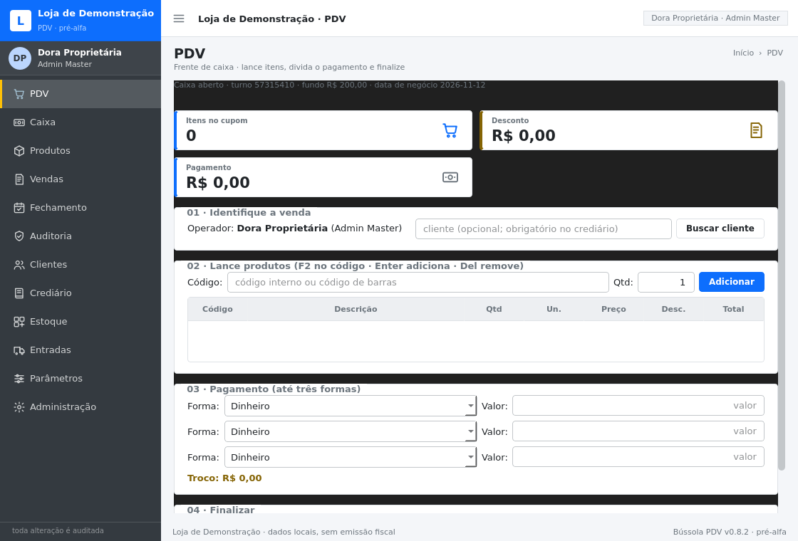
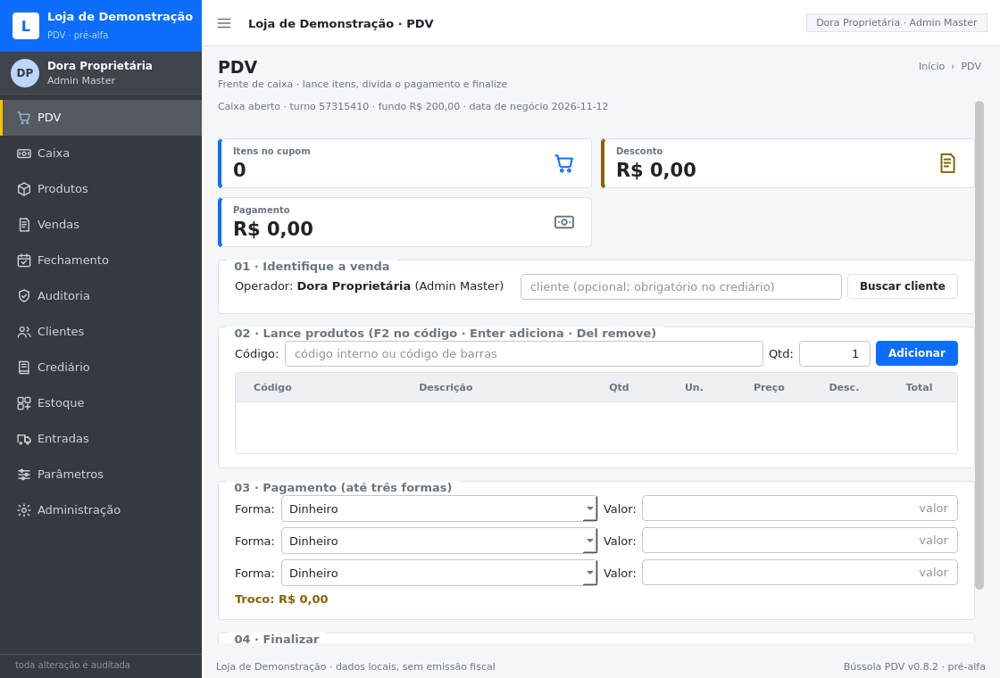
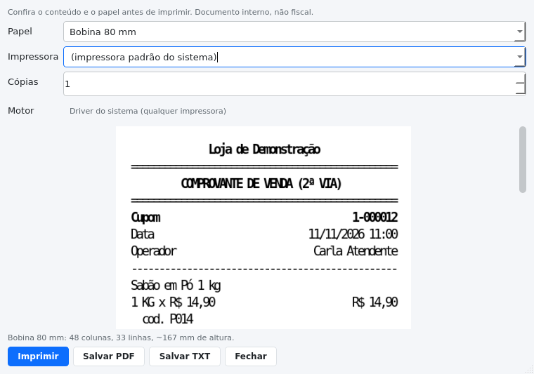

# Interface: linguagem visual e componentes

A interface segue a **linguagem visual do [AdminLTE](https://github.com/ColorlibHQ/AdminLTE)**
(dashboard administrativo em Bootstrap, MIT): barra lateral escura com a marca no topo, painel do
usuário, menu com ícones, barra superior com botão de recolher, cabeçalho de página com trilha,
cartões brancos sobre fundo cinza-azulado, *small-boxes* coloridas para indicadores, etiquetas de
status e rodapé discreto.

**O que é aproveitado:** hierarquia, densidade, proporções (cantos de 4 px, sombras discretas),
vocabulário de componentes e a ideia de skin. **O que não é aproveitado:** nenhum arquivo do projeto
original — não há CSS, HTML, fonte, imagem ou ícone do AdminLTE neste repositório. Tudo é
reconstruído em PySide6 (QSS + widgets) e pintado com a **paleta da loja**, para que a
personalização de cores do painel administrativo continue valendo.

## Estrutura da casca

```
┌───────────────┬──────────────────────────────────────────────┐
│ marca (faixa) │ ☰  Loja · Módulo                  [usuário]  │  barra superior (52 px)
│ painel usuário├──────────────────────────────────────────────┤
│               │ Módulo                     Início › Módulo   │  cabeçalho de conteúdo
│  navegação    ├──────────────────────────────────────────────┤
│  (ícones)     │  [KPI] [KPI] [KPI]                           │
│               │  cartão / grupo / tabela                     │  conteúdo
│               │                                              │
│ rodapé        ├──────────────────────────────────────────────┤
└───────────────┴──────────────────────────────────────────────┘  rodapé
```

A side bar recolhe para 62 px (só ícones) pelo botão `☰`; os rótulos ficam no *tooltip*.

## Cores (tokens)

Tudo sai de `dominio/marca.Paleta` e vira QSS em `ui/tema.py`. A skin padrão é a do AdminLTE:

| Token | Padrão | Papel |
|---|---|---|
| `primaria` | `#0D6EFD` | botões, faixa da marca, links |
| `primaria_escura` | `#343A40` | barra lateral, item ativo, tooltip |
| `secundaria` | `#17A2B8` | informação, ícone de indicador |
| `secundaria_clara` | `#D3E9F0` | seleção suave |
| `destaque` | `#FFC107` | item ativo da navegação, avisos |
| `fundo` | `#F4F6F9` | fundo do conteúdo |
| `superficie` | `#FFFFFF` | cartões, tabelas, barra superior |
| `texto` / `texto_suave` | `#212529` / `#5F686F` | texto principal / secundário (cinza corrigido para ≥4,5:1 sobre o fundo) |
| primária sobre texto | decisão automática | `tinta_sobre(cor)` escolhe branco ou quase-preto pela razão de contraste |
| `sucesso` / `alerta` / `erro` | `#198754` / `#856404` / `#B02A37` | estados |
| `borda` | `#DEE2E6` | bordas e divisórias |
| `entrada` | `#FFFFFF` | fundo de campos |

Presets: `BUSSOLA` (padrão), `GRAFITE`, `ESMERALDA`, `NOTURNO`, `OCEANO`, além de
`PERSONALIZADO` quando o lojista troca uma cor. Paletas com contraste abaixo de 4,5:1 recebem aviso
na tela de tema; se o branco sobre a primária não passar, o texto do botão vira escuro.

## Componentes (`ui/widgets.py`)

| Componente | Equivalente no AdminLTE | Uso |
|---|---|---|
| `BarraLateral` | `main-sidebar` | marca, painel do usuário, navegação com ícones, recolher |
| `BarraSuperior` | `main-header` | botão de recolher, título da página, chip do usuário |
| `CabecalhoConteudo` | `content-header` + `breadcrumb` | título e trilha da página |
| `Cartao` | `card` | cabeçalho (título/subtítulo/ferramentas) + corpo |
| `CaixaInfo` | `small-box` | indicador com número grande, rótulo e ícone |
| `Selo` | `badge` | status: ativo, ruptura, cancelado, conciliado |
| `PilhaDePaginas` | — | pilha cuja altura segue a página visível |
| `Rodape` | `main-footer` | nome da loja, aviso de escopo e versão |
| `BotaoExportar` | `card-tools` + `dropdown` | menu Excel/PDF no cabeçalho do cartão; só aparece para quem tem `EXPORTAR_DADOS` |
| `BotaoImprimir` | `card-tools` | abre a prévia de impressão do documento que a tela montar; só aparece com `CUPOM_REIMPRIMIR` |
| `DialogoPreviaImpressao` | `modal` | papel (58/80/A4), impressora instalada, cópias, prévia desenhada e ações Imprimir / Salvar PDF / Salvar TXT |
| `ajustar_colunas` | `table-responsive` | coluna esticada + demais pelo conteúdo, para não cortar "Ponto de pedido" |

## Ícones (`ui/icones.py`)

25 desenhos SVG de 24×24 escritos neste repositório, com traço de 1,8 e pontas arredondadas,
coloridos em tempo de execução (cache por nome/cor/tamanho). Não há dependência de rede nem de
pacote de ícones; nome inexistente devolve ícone vazio em vez de quebrar a tela.

## Responsividade (ADR-021)

A interface não tem um tamanho de projeto: ela pergunta a largura e se reorganiza. Tudo o que decide
isso mora em `ui/responsivo.py` — nenhuma tela compara pixels por conta própria.

| Faixa | Largura | O que muda |
|---|---|---|
| **compacta** | < 900 px | sidebar recolhida (só ícones, com dica de tela), chip do usuário, trilha e lado direito do rodapé escondidos, margem de 18 → 10 px |
| **média** | 900–1179 px | sidebar aberta, chip visível, indicadores até 3 por linha |
| **ampla** | ≥ 1180 px | layout completo, até 4 indicadores por linha |

Peças que reagem à largura:

- **`GradeDeIndicadores`** — cartões de indicador em `QGridLayout`: 4 → 3 → 2 → 1 por linha, e a altura
  mínima cresce com o número de linhas (sem isso o segundo cartão era desenhado sobre o primeiro).
- **`CascaResponsiva`** — herdado por `JanelaPrincipal` e `JanelaAdmin`: recolhe a sidebar na faixa
  compacta, esconde os complementos e ajusta margens. O botão do menu continua valendo: a escolha
  manual do operador dura até a janela mudar de faixa.
- **Contraste é requisito, não acabamento.** Antes e depois, com a paleta escura do Windows
  aplicada de propósito:
  
   `criar_aplicacao()` fixa estilo `Fusion` e uma
  `QPalette` clara derivada da marca (`tema.paleta_do_tema`): com o Windows em modo escuro, o Qt
  entregava paleta escura e o `QScrollArea` transparente mostrava preto atrás dos cartões. A folha
  pinta `QScrollArea`, o viewport e `#pagina`. A tinta de rótulo sobre cor (`tinta_sobre`) e o cinza
  do texto secundário (`garantir_contraste`) saem da **razão de contraste WCAG** — 4,5:1 para texto
  pequeno —, não de luminosidade média.
- **`Cartao`** — cabeçalho em grade: abaixo de 640 px de cartão, as ferramentas ("Exportar", resumo da
  consulta) descem para a segunda linha em vez de alargar a página. Dentro da moldura de ferramentas há
  um `FluxoDeAcoes`: com "Exportar" **e** "Imprimir" lado a lado a soma das larguras voltava a impor
  largura mínima (Produtos pedia 732 px, Vendas 823 px) e o fluxo quebra a fileira.
- **`ColunasDaTabela`** — mede o conteúdo (adiado 150 ms): se cabe, estica a coluna elástica; se não
  cabe, mantém cada coluna legível (piso de 84 px) e liga a rolagem horizontal da própria tabela.
- **`QScrollArea`** em volta da pilha de páginas, nas duas janelas — em 600 px de altura o PDV rola em
  vez de sobrepor os grupos, e a área administrativa usa `PilhaDePaginas` para não herdar a largura
  mínima da seção mais larga.
- **`FluxoDeAcoes`** — fileiras de botões quebram em várias linhas; `QHBoxLayout` não quebra e a
  fileira de ações de Usuários saía pela borda em 800 px. Também é a fileira de filtros da tela de
  Vendas (datas, Filtrar, Reimprimir cupom, Cancelar venda). Reparentar esconde o filho, então
  `adicionar()` só chama `show()` quando o widget não estava escondido de propósito — senão o botão
  sem permissão reaparecia.
- **`GradeDeCartoes`** — dois blocos de conteúdo lado a lado (identidade/prévia da marca) empilham
  quando não cabem.
- **`ajustar_dialogo()`** — login, autorização, primeiro uso e conferência de gaveta nunca nascem
  maiores do que a tela.

### Abrir dentro da tela (v0.9.1)

- **`abrir_no_tamanho_da_tela()`** — o tamanho inicial vem de
  `QGuiApplication.primaryScreen().availableGeometry()`, não de um número fixo. Pedir 1280×820 num
  notebook 1366×768 com escala de **150%** (espaço lógico 911×512) fazia a janela nascer **maior do
  que o monitor**: o Windows a cortava e o rodapé e os botões da direita desapareciam. Agora o pedido é
  um **teto** — 92% da área útil, centralizada, nunca abaixo do mínimo declarado.
- As duas janelas recusam ficar menores que **640×440**, e esse mínimo cabe em 911×512 (1366×768 a
  150%) e em 1024×768. Antes, o piso **real** era 737 px (operação) e 946 px (administração) — este
  último maior do que a tela de um notebook a 125%, por causa das larguras mínimas somadas de rodapé,
  cabeçalho e cartões.
- **`RotuloElastico`** — rodapé, barra superior, nome da loja e nome do operador cortam com "…" e
  guardam o texto completo no `toolTip`. Um `QLabel` comum exige a largura do texto: o rodapé sozinho
  pedia 585 px e virava o piso da janela administrativa. `.text()` continua devolvendo o texto inteiro.
- **`Cartao.minimumSizeHint()`** — o cabeçalho do cartão (título + ferramentas) sempre cabe empilhado,
  então não é ele que dita o mínimo; valia a soma dos dois (614 px na Auditoria).
- **`FluxoDeAcoes` no "04 · Finalizar"** do PDV — total e três botões lado a lado somavam 731 px e
  passavam da página; agora descem de linha.
- **`RolagemDeCartao`** — os diálogos de login, autorização e primeiro uso ficam dentro de uma rolagem
  que pede a altura do cartão e aceita ser encolhida: em 512 px lógicos o formulário de primeiro uso
  era cortado em cima e embaixo, sem barra para chegar ao resto.
- **Campos proporcionais** — o combo de forma de pagamento e o campo de valor recebiam 760 px cada um
  em 1920 (caixa enorme, texto perdido no meio, valor longe do rótulo). O bloco de pagamento passou a
  ter teto de **620 px**, o combo até 300 e o valor até 420; a quantidade saiu da largura fixa de 80 px
  para a faixa 56–88.
- **`CaixaInfo`** com altura mínima de 74 px: o valor em corpo grande vem do QSS, e o `sizeHint` do
  `QLabel` é medido antes de a folha ser aplicada — com 56 px o número aparecia cortado embaixo quando
  a grade refluía para duas colunas.

Medido, não só olhado: `make responsivo` (`ferramentas/verificar_responsivo.py`) abre as duas janelas em
**640×440, 800×600, 911×512 (1366×768 a 150%), 1024×768, 1280×800, 1366×768, 1920×1080 e 2560×1440** e
falha se alguma página pedir mais largura do que tem, se uma coluna descer do mínimo legível, se a
sidebar recolher sem motivo, se a faixa não bater com a largura, se o campo de pagamento esticar além do
teto, se a janela abrir maior do que a área útil da tela ou menor do que o próprio mínimo. Hoje: **OK nas
oito resoluções**.

## Regras que a interface respeita

1. **A tela não calcula.** Cálculo é domínio; widget só mostra e emite intenção (ADR-012).
2. **Cor é dado.** A paleta vem do banco via `Marca`; nada de cor fixa em widget.
3. **Estado não é só cor.** Status aparece com texto + etiqueta, nunca apenas com cor.
4. **Nada é simulado.** Módulo inexistente mostra cartão explícito dizendo que não foi implementado
   (hoje: **Entradas** e **Parâmetros**).
5. **Tela de consulta desenha o relatório.** Clientes, Crediário e Estoque montam a tabela a partir do
   mesmo `Relatorio` que o botão Exportar grava (ADR-019): o que está na tela e o que vai para a
   planilha são a mesma consulta, no mesmo instante.
6. **Tudo que altera é auditado** — o rodapé lembra isso em todas as telas.

## Capturas

`docs/capturas/` é gerado por `make capturas` (`ferramentas/captura_telas.py`, Qt offscreen, sem
servidor gráfico): PDV vazio e com itens, caixa (e o caixa com o *Exportar* do turno), produtos,
fechamento, **clientes**, **crediário**, **estoque**, auditoria, login, as seis seções
administrativas, tema personalizado, menu recolhido e **primeiro uso** (tela onde se escolhe a
pasta dos dados). As capturas `21`, `22` e `23` são o mesmo PDV, Produtos e Caixa em **800×600**: ficam
ao lado das de 1280×820 para mostrar a interface se reorganizando (sidebar só de ícones, indicadores 2
por linha, ferramentas do cartão na segunda linha, tabela rolando na horizontal). As capturas `28` e
`29` são o PDV e Vendas em **911×512** — o que sobra de tela em 1366×768 com escala de 150% do Windows.

As capturas de fechamento, clientes, crediário, estoque e do caixa com exportação usam a sessão de
gerente de propósito: o perfil Atendente não tem `EXPORTAR_DADOS` e, para ele, o botão não existe —
o que é o comportamento correto.


## Impressão (`ui/impressao.py`)

A prévia é o único lugar da interface que conhece `QPrinter`: as telas chamam `BotaoImprimir` com uma
função que devolve o `DocumentoImpresso` **no clique**, e o diálogo cuida do resto. Ver
[IMPRESSAO.md](IMPRESSAO.md) para configuração e para o que foi (e não foi) testado.

- **Prévia no tamanho real do papel** — o cupom é desenhado em grade de colunas por
  `infra/impressao/papel.py`; a tela mostra a imagem gerada pelo mesmo código que imprime, então
  prévia e papel não divergem;
- **Papel trocável na hora** (58 ↔ 80 ↔ A4) com as medidas à vista: colunas, linhas e altura estimada;
- **Aviso quando o motor não serve**: `ESCPOS` + A4 mostra "o motor ESC/POS imprime bobina" em vez de
  falhar só no envio;
- **Falha com saída**: erro de impressora aparece no diálogo, com o motivo, e a venda continua
  registrada — o operador pode salvar PDF, tentar de novo (F8) ou seguir o expediente;
- **Onde está**: PDV (cupom e F8), Caixa (turno), Vendas (2ª via da venda selecionada) e o botão
  "Imprimir" ao lado do "Exportar" em todas as telas de relatório — nesse caso montado por
  `botao_para_relatorio()`, que usa a **mesma** função do `BotaoExportar`, só trocando o formato de
  saída. A permissão muda junto: cupom pede `CUPOM_REIMPRIMIR`, relatório pede `EXPORTAR_DADOS`.


